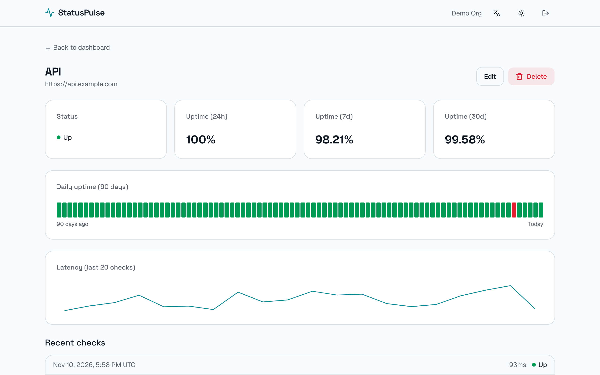
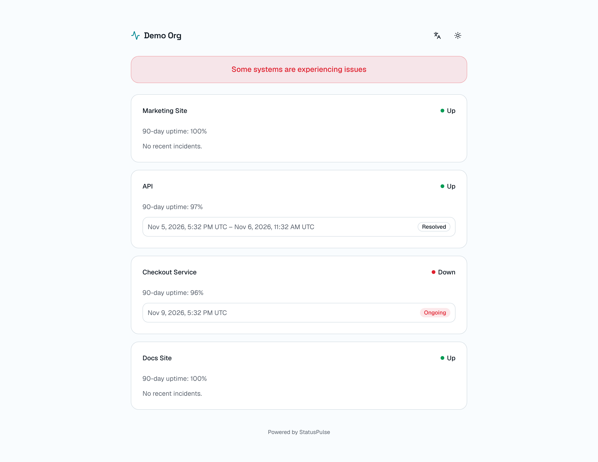
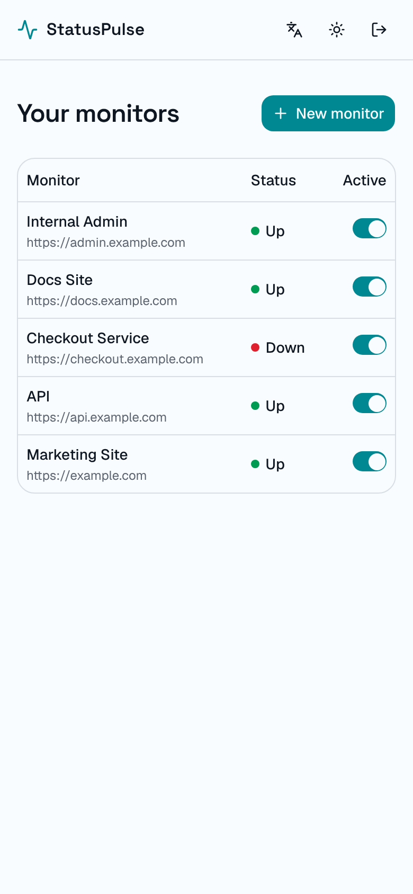
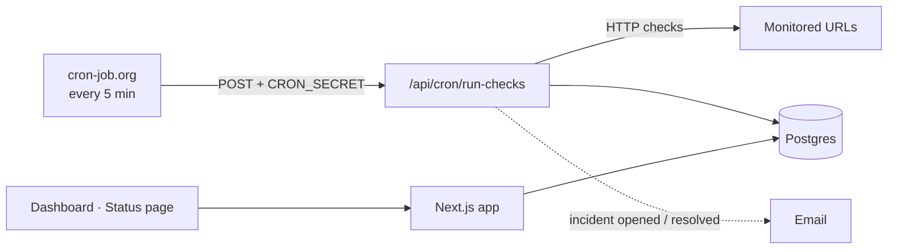

# StatusPulse

[](https://github.com/chrismoussounda/status-pulse/actions/workflows/ci.yml)

Uptime monitoring with public status pages. Add the URLs you care about;
StatusPulse checks them every few minutes, opens an incident and emails you
when one goes down, and publishes a shareable status page in French or
English.

**Live demo:** [status-pulse-eta.vercel.app/en/status/demo](https://status-pulse-eta.vercel.app/en/status/demo)

| Monitor detail                                         | Public status page                                      | Mobile                                                                                 |
| ------------------------------------------------------ | ------------------------------------------------------- | -------------------------------------------------------------------------------------- |
|  |  |  |

## Features

- **HTTP monitoring** with custom method, expected status and interval
- **Incident detection** after 3 consecutive failures, so one blip doesn't page you
- **Email alerts** when an incident opens and when it resolves (Resend)
- **Uptime stats** for 24h / 7d / 30d / 90d, with 90-day daily uptime bars
- **Public status page** per account, with private monitors kept off it
- **REST API** for monitors ([OpenAPI spec](docs/openapi.yaml))
- **SSRF protection**: monitors can't target internal or cloud-metadata addresses
- French / English, light / dark, responsive down to phone width

## Stack

Next.js 16 (App Router) · TypeScript · Postgres + Prisma · NextAuth v5 ·
Tailwind v4 + shadcn/ui · next-intl · Resend · Vitest · GitHub Actions ·
Vercel + Neon



There's no always-on server: an external cron service is the scheduler,
calling a stateless route on Vercel. The reasoning behind this and other trade-offs is
in [docs/decisions.md](docs/decisions.md).

## Run it locally

Requires Node 22+, [pnpm](https://pnpm.io) and Docker.

```bash
cp .env.example .env    # defaults match docker-compose.yml
docker compose up -d    # local Postgres
pnpm install
pnpm run db:migrate
pnpm run db:seed        # optional demo data
pnpm run dev
```

Open http://localhost:3000. The demo account is `demo@statuspulse.dev` /
`demo-password-123`, and its public page is `/en/status/demo`.

Nothing schedules checks in dev; trigger a run by hand:

```bash
curl -X POST http://localhost:3000/api/cron/run-checks -H "Authorization: Bearer $CRON_SECRET"
```

## Tests

```bash
pnpm run test        # unit + integration tests (needs the Docker Postgres)
pnpm run lint
pnpm run typecheck
```

CI runs format check, lint, typecheck, tests and a production build against a
fresh Postgres on every pull request.

## Deploy

1. **Neon:** create a database. Put the pooled connection string in
   `DATABASE_URL` and the direct one in `DIRECT_URL`.
2. **Vercel:** import the repo and set the variables from `.env.example`
   (`NEXTAUTH_URL` is your deployed URL). Migrations run automatically during
   the build.
3. **Scheduler:** create a job on [cron-job.org](https://cron-job.org) (or
   any cron service) that sends `POST <your URL>/api/cron/run-checks` every 5
   minutes with the header `Authorization: Bearer <CRON_SECRET>`.

To trigger a run by hand from GitHub, add `CRON_SECRET` as an Actions secret
and your deployed URL as an Actions variable named `APP_URL`, then start the
`Run checks` workflow.

## License

[MIT](LICENSE)
