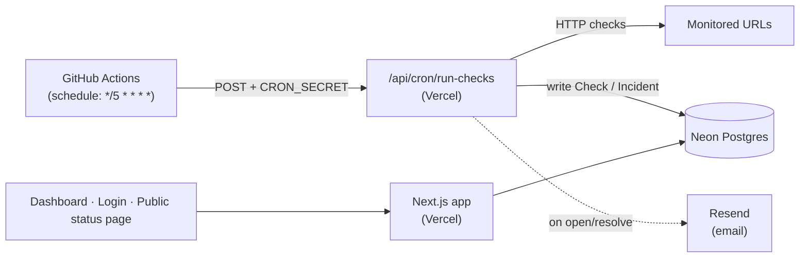
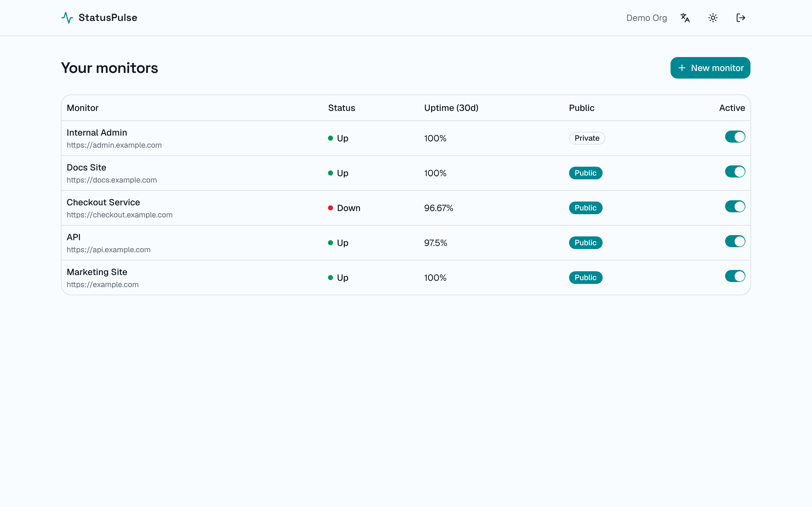

# StatusPulse

An uptime monitoring & public status-page tool. Add HTTP endpoints to watch; a
scheduled check runner detects incidents and publishes a shareable public
status page per account, in French or English.

> **Status:** feature-complete for this phase — auth, monitor CRUD, the check
> runner with consecutive-failure incident detection and email
> notifications, dashboard uptime/latency stats, and the public status page
> are all in. See the [issues](../../issues) for the backlog.

## Stack

Next.js (App Router) + TypeScript, Prisma + Postgres, NextAuth (Credentials),
Resend (email), next-intl (French default, English secondary), shadcn/ui on
Tailwind v4 with a custom theme, deployed on Vercel with a GitHub Actions
cron workflow driving the check runner. See **Engineering Decisions** below
for why.

## Architecture



No persistent scheduler process — GitHub Actions is the "always-on" part,
calling a stateless, secret-protected route on Vercel. See **Engineering
Decisions** for why, and for the concurrency/timeout math that keeps one
route invocation inside a serverless time budget.

## Screenshots

| Dashboard                                    | Public status page                                      | Mobile (390px)                                                                         |
| -------------------------------------------- | ------------------------------------------------------- | -------------------------------------------------------------------------------------- |
|  |  |  |

## Getting started

Requires Node 22+, [pnpm](https://pnpm.io), and Docker.

```bash
git clone <repo-url>
cd status-pulse
cp .env.example .env      # defaults already match docker-compose.yml
docker compose up -d      # starts local Postgres
pnpm install               # also generates the Prisma client (postinstall)
pnpm run db:migrate        # applies migrations to the local database
pnpm run dev
```

Open [http://localhost:3000](http://localhost:3000) — it redirects to `/fr`
by default (English at `/en`).

### Demo data

```bash
pnpm run db:seed
```

Creates `demo@statuspulse.dev` / `demo-password-123` with 5 monitors and
~30 days of check history (`prisma/seed.ts`) — one with a resolved past
incident, one currently down (so the public status page isn't a wall of
green), one private (to see tenant isolation). Re-running it wipes and
recreates the same demo account, so it's safe to run repeatedly. Public
page: `/fr/status/demo`.

### Triggering the check runner locally

There's no scheduler running in dev — call the route directly with the
`CRON_SECRET` from your `.env`:

```bash
curl -X POST http://localhost:3000/api/cron/run-checks \
  -H "Authorization: Bearer $CRON_SECRET"
```

Without `RESEND_API_KEY` set, notification emails log a warning and no-op
instead of failing — you'll still see Check/Incident rows update.

## Scripts

| Script                   | What it does                                  |
| ------------------------ | --------------------------------------------- |
| `pnpm run dev`           | Start the dev server                          |
| `pnpm run build`         | Production build                              |
| `pnpm run lint`          | ESLint                                        |
| `pnpm run typecheck`     | Generate route types, then `tsc --noEmit`     |
| `pnpm run test`          | Run the test suite once (Vitest)              |
| `pnpm run test:watch`    | Run tests in watch mode                       |
| `pnpm run test:coverage` | Run tests with coverage                       |
| `pnpm run format`        | Format the codebase with Prettier             |
| `pnpm run format:check`  | Check formatting without writing              |
| `pnpm run db:migrate`    | Apply Prisma migrations to the local database |
| `pnpm run db:generate`   | Regenerate the Prisma client                  |
| `pnpm run db:seed`       | Wipe and recreate the demo account            |

CI runs lint → typecheck → test → build (with migrations applied to a fresh
Postgres service container) on every pull request — see
`.github/workflows/ci.yml`. A separate scheduled workflow
(`.github/workflows/cron.yml`) calls the check runner every 5 minutes in
production; it needs the `APP_URL` and `CRON_SECRET` repo secrets set.

## API

The web UI talks to the database through Next.js Server Actions, and the
same capabilities are also exposed as a REST API for scripts and integrations.
Full spec: [`docs/openapi.yaml`](docs/openapi.yaml) (paste into
[editor.swagger.io](https://editor.swagger.io) to browse it rendered).

| Method | Path                   | Auth                 | What                                       |
| ------ | ---------------------- | -------------------- | ------------------------------------------ |
| POST   | `/api/signup`          | none                 | Create an account                          |
| GET    | `/api/monitors`        | session              | List your monitors                         |
| POST   | `/api/monitors`        | session              | Create a monitor                           |
| GET    | `/api/monitors/{id}`   | session              | Get one monitor                            |
| PATCH  | `/api/monitors/{id}`   | session              | Update a monitor                           |
| DELETE | `/api/monitors/{id}`   | session              | Delete a monitor                           |
| POST   | `/api/cron/run-checks` | `CRON_SECRET` bearer | Run due checks (GitHub Actions calls this) |

`/api/monitors/{id}` returns 404 — never 403 — for another account's
monitor; see Engineering Decisions.

## Deployment

1. **Neon**: create a Postgres project, copy the pooled connection string
   into `DATABASE_URL` and the unpooled (direct) one into `DIRECT_URL`.
2. **Vercel**: import the repo, set `DATABASE_URL`, `DIRECT_URL`,
   `NEXTAUTH_URL` (your deployed URL), `NEXTAUTH_SECRET` (a random 32-byte
   value), `CRON_SECRET` (any random string), and `RESEND_API_KEY` as
   project env vars. The `build` script runs `prisma migrate deploy` before
   `next build`, so every deploy applies any pending migrations
   automatically — no separate migration step.
3. **GitHub Actions**: add the same `CRON_SECRET` as a repo secret, and the
   deployed URL as a repo _variable_ named `APP_URL` (Settings → Secrets
   and variables → Actions) — `.github/workflows/cron.yml` needs both.
4. Optionally run `pnpm run db:seed` against the production database (with
   `DATABASE_URL` pointed at Neon) so the deployed demo isn't empty.

## Engineering Decisions

**Why an external cron instead of an in-process scheduler.** Vercel's Hobby
tier can't run a persistent `node-cron` loop — serverless functions exit when
the request completes — and its own Cron Jobs feature is capped at once a day
on the free tier. Checks instead run behind a secured API route
(`/api/cron/run-checks`, protected by a `CRON_SECRET` bearer token) that a
GitHub Actions scheduled workflow calls every 5 minutes. It's a real
constraint of free-tier hosting, worked around with the simplest thing that
fits it — not hidden.

**Why no job queue.** At this scale, an external cron hitting a stateless
route is already the simplest thing that works. A queue (BullMQ/Redis) would
add infrastructure this project doesn't need yet — see the check-runner
concurrency note below for how the route itself stays within a serverless
timeout without one.

**Check-runner concurrency and timeout budget.** A single invocation of
`/api/cron/run-checks` checks every monitor due in that cycle
(`lib/check-runner.ts`). It uses a small hand-rolled worker pool (10
concurrent checks, no dependency) with a per-check `AbortController` timeout
(10s), so one slow endpoint can't stall the whole batch and unbounded
parallelism can't blow the function's `maxDuration` (set to 60s on the
route).

**Consecutive-failure threshold before opening an incident.**
`lib/checks/decide-incident-action.ts` is a pure function — no DB access —
so it opens an incident only after 3 consecutive DOWN checks, not on the
first one. A single failed check is treated as noise (a transient network
hiccup), not an incident; the threshold is a plain constant
(`CONSECUTIVE_FAILURE_THRESHOLD`), and every flap scenario (fail-fail-recover,
fail-recover-fail, sustained outage then recovery) is a unit test rather
than something that needs a real database to exercise. The count itself is
denormalized onto `Monitor.consecutiveFailures` (reset to 0 on any UP) so
the check runner doesn't need to re-scan Check history on every run.

**Email notifications are best-effort and go straight to the account
owner's email.** `lib/checks/record-check-result.ts` writes the Check row,
denormalized Monitor state, and any Incident open/resolve in one
transaction, then sends an email via Resend _after_ the transaction
commits, with a `.catch()` — a failed send can't roll back state that's
already correct, or abort the rest of the check-runner batch for other
monitors. There's no per-channel configuration UI (the `NotificationChannel`
model exists in the schema but isn't wired up yet): every account gets
email notifications to its signup address, which covers the common case
without building settings UI this phase doesn't need. Without
`RESEND_API_KEY` set, `sendEmail` logs and no-ops instead of throwing, so
this works locally and on a demo deploy with no Resend account.

**Uptime and latency are computed on read, not stored.**
`calculateUptimeSummary` (24h/7d/30d, `null` — not 0 or 100 — when a window
has no data) and `getLatencySeries` are both pure functions over the
`Check` rows already being fetched for the page, unit-tested against
hand-computed fixtures. No separate rollup table or scheduled aggregation
job — at this data volume a scan of the last N checks is cheap enough that
precomputing would be optimizing a cost that doesn't exist yet.

**Migrations run as part of the build, not a separate step.** Vercel has no
release-phase hook like Heroku's, so `prisma migrate deploy` is prepended
to the `build` script instead of relying on a separate CI/deploy step. It's
idempotent (a no-op once migrations are applied), so this is also harmless
in CI, which already applies migrations explicitly before tests run.

**Why `directUrl` alongside `url` in the Prisma datasource.** Neon's free
tier has a real connection cap, and serverless functions can open a new
connection per invocation. Production uses the pooled (`-pooler`) connection
string for `DATABASE_URL` and the unpooled one for `DIRECT_URL`, since
`prisma migrate` can't run through a connection pooler. Locally, both point
at the same Docker Postgres instance.

**Auth scope.** Sign up/login uses NextAuth v5 (beta) with the Credentials
provider and bcrypt-hashed passwords — no email verification, password reset,
or OAuth providers in this scope. That's a deliberate cut to keep auth from
eating the time budget for the check runner and incident detection, which are
the parts of this project that aren't a CRUD-app rerun. What I'd add for
production: email verification, a password reset flow, and rate-limited
login attempts. NextAuth v5 is still in beta with no stable release, but it's
the only line with proper Next.js 16 App Router / React 19 support; the
Credentials provider and JWT sessions are stable, low-surface-area parts of
it. `trustHost: true` is required in `lib/auth.config.ts` for any deployment
NextAuth can't auto-detect as Vercel (self-hosted, Docker) — otherwise every
request is rejected as `UntrustedHost`.

**Cross-tenant isolation.** Monitor and incident queries are scoped by the
authenticated user's ID, and a request for another user's resource returns
404 rather than 403 — a 403 would confirm the resource exists to someone who
shouldn't be able to tell that. Enforced in server actions/pages (via
`prisma.monitor.findFirst({ where: { id, userId } })`), not in middleware —
middleware only knows a route matched `/dashboard/**`, not who owns the
resource inside it.

**i18n: French default, English secondary, locale-prefixed routes.**
next-intl with `/fr/...` and `/en/...` routes (`i18n/routing.ts`), French as
`defaultLocale`. All in-content copy (UI labels, form validation messages,
error text) is translated via `messages/fr.json` / `messages/en.json`;
identifiers, code, and comments stay in English. Locale-prefixed routes were
chosen over a client-side-only toggle because it's the standard, SEO-friendly
Next.js pattern and doesn't need reworking later if this becomes a real
product. The proxy (`proxy.ts`, formerly `middleware.ts` — renamed per
Next.js 16's convention) chains next-intl's locale middleware with the
NextAuth edge session check.

**Theme: shadcn/ui with a custom palette, manual light/dark toggle.** shadcn's
default CLI theme was replaced with a distinct teal/indigo palette, a rounder
radius scale, and a Space Grotesk display face paired with Geist Sans
(`app/globals.css`). Dark mode uses next-themes with a `.dark` class and a
visible toggle (not just OS `prefers-color-scheme`), since visitors — public
status-page viewers especially — should be able to override it. A custom
`3xl` (1920px) breakpoint keeps wide layouts from stretching full-width.

_(This section grows as each epic lands — the goal is that by ship, it
covers every non-obvious trade-off in the project, not just the ones above.)_
